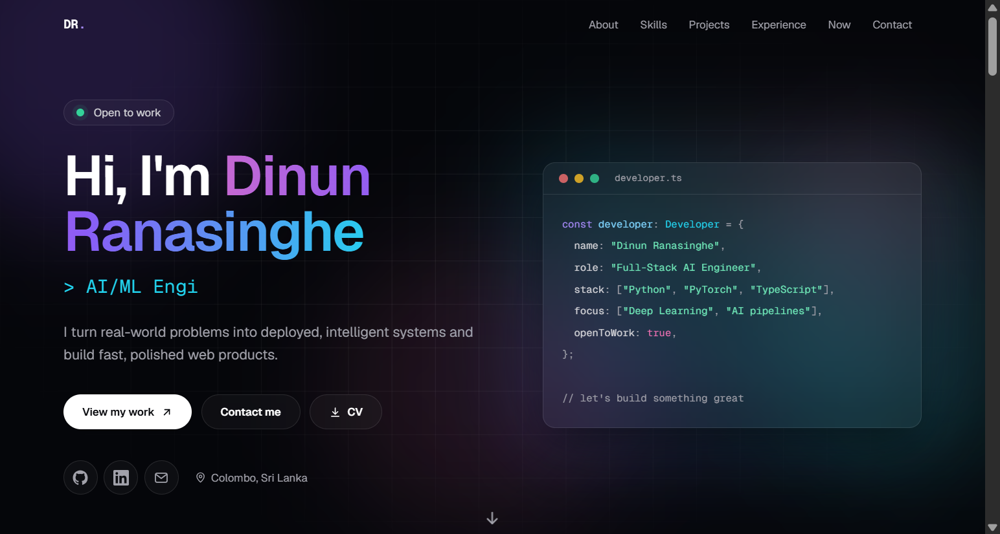
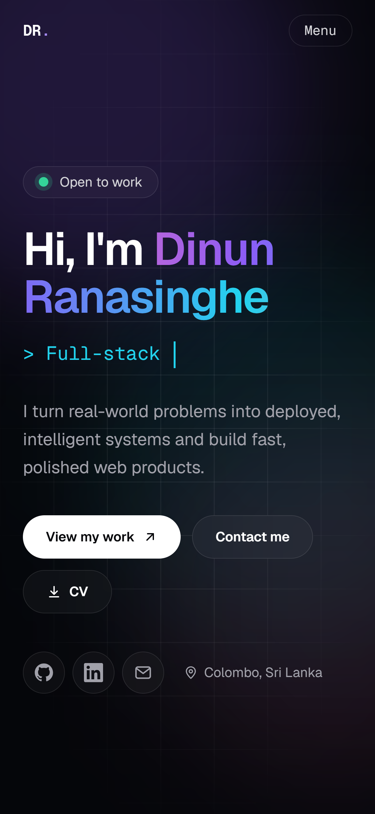

# Dinun Ranasinghe | Portfolio

I've created a fast, animated portfolio from scratch with Next.js, TypeScript and Tailwind CSS.

**Live:** https://portfolio-dinun.vercel.app

<p>
  
  
</p>

## Features

- Sections for About, Skills, Projects, Experience, Now and Contact
- Hero with a typewriter role line, a floating `developer.ts` code window, a pulsing availability badge and a one-click **CV download**
- Skills shown as animated percentage bars that fill as they scroll into view
- Experience as a centred timeline whose cards alternate left and right, with a line that draws itself
- All content in one typed file (`lib/data.ts`), so updating the site means editing data, not markup
- Scroll reveals, spotlight and tilt cards, animated background (Framer Motion and CSS)
- Sticky navigation with active-section highlighting and an accessible mobile menu
- SEO: metadata, Open Graph image and favicon generated with `next/og`, sitemap, robots, JSON-LD
- Accessibility: semantic HTML, skip link, visible focus, progress-bar roles for skill levels, reduced-motion support, WCAG AA contrast

## Performance

Lighthouse, mobile, production build (October 2026) opens in an incognito web:

| Performance | Accessibility | Best Practices | SEO |
| ----------- | ------------- | -------------- | --- |
| 90          | 100           | 100            | 100 |

Cumulative Layout Shift is 0. The remaining cost is mostly JavaScript, from the animation library and the framework runtime.

## Tech stack

Next.js (App Router), React, TypeScript (strict), Tailwind CSS, Framer Motion, ESLint, Prettier, Vitest and Testing Library, Playwright, GitHub Actions, Vercel.

## Getting started

```bash
npm install
npm run dev
```

Open http://localhost:3000.

| Script                 | What it does                                      |
| ---------------------- | ------------------------------------------------- |
| `npm run dev`          | Start the dev server                              |
| `npm run build`        | Production build                                  |
| `npm run lint`         | ESLint                                            |
| `npm run typecheck`    | TypeScript check                                  |
| `npm run format:check` | Prettier check                                    |
| `npm run verify`       | Lint, typecheck, format check and build in one go |
| `npm test`             | Unit and component tests (Vitest)                 |
| `npm run test:e2e`     | End-to-end tests (Playwright)                     |

## Editing the content

- Everything on the page comes from `lib/data.ts`: profile, skills (each with a 0 to 100 level), projects, experience and links.
- To update the downloadable CV, replace `public/Dinun-Ranasinghe-CV.pdf` and keep the same file name.

## Project structure

```
app/          layout, page, metadata routes (icon, Open Graph image, robots, sitemap)
components/   section components, the Hero code window and reusable animation blocks
lib/          typed content (data.ts), types, site URL helper
public/       static assets (the CV PDF)
e2e/          Playwright tests
docs/         screenshots used in this README
```

## How it is built and shipped

- Work happens on short-lived feature branches and merges through pull requests with Conventional Commit messages.
- GitHub Actions runs lint, typecheck, format check, unit tests, build and end-to-end tests on every PR.
- `main` is protected: a PR and a passing `checks` job are required.
- Vercel deploys `main` to production and creates a preview for every PR.
- Dependabot opens weekly dependency PRs, grouping minor and patch updates, and they go through the same checks.

## Decisions

- **No database.** The content changes rarely and lives in version control, so a database would add cost and failure modes for no benefit.
- **Server components by default.** Only components that need state, effects or animation are client components.
- **Tests at two levels.** Fast component and data-integrity tests, plus a few end-to-end tests of real user flows against the production build. One of them downloads the CV and checks it is served as a PDF.
- **Skill levels are numbers, not labels.** A 0 to 100 value renders as a real `progressbar` for screen readers, and a data test rejects anything outside that range.
- **Major upgrades are deliberate.** Dependabot ignores major TypeScript and Tailwind releases. Tailwind 4 changes the config model, so it will be a planned migration in its own PR.
- **Respect for reduced motion.** Every animation either checks the user's preference or is neutralised by a global rule.

## Roadmap

- Migrate to Tailwind CSS 4
- Load Framer Motion features lazily to cut unused JavaScript on mobile
- Optional contact form with server-side validation

## Author

Dinun Ranasinghe, AI/ML engineer, Colombo, Sri Lanka.
[GitHub](https://github.com/dinun0427) | [LinkedIn](https://www.linkedin.com/in/dinun-ranasinghe/)
